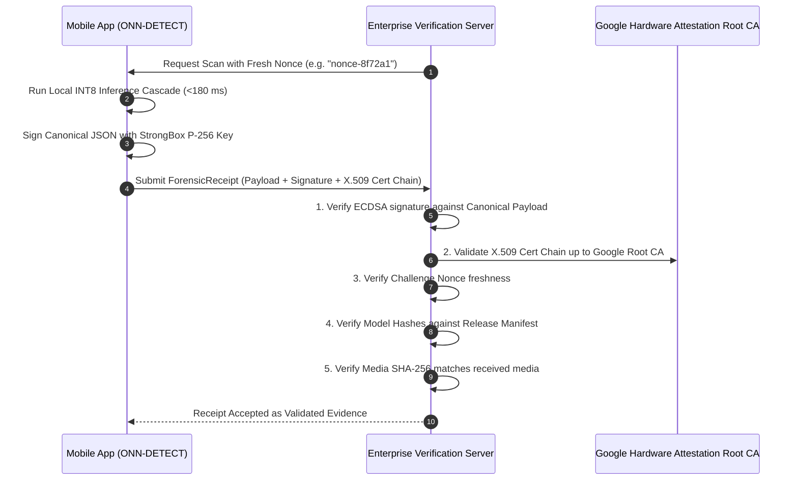

# ONN-DETECT Forensic Receipt Specification (v1)

**Schema:** `onn-receipt-v1`  
**Standard:** RFC 8785 (Canonical JSON) + NIST SP 800-56A (ECDSA P-256 / SHA-256) + Android Key Attestation (KeyMint / StrongBox)  
**Security Level:** Hardware-Isolated (Android StrongBox HSM / Hardware TEE)  
**Primary Class:** [`ForensicReceipt.kt`](file:///android/app/src/main/java/com/onndetect/detection/provenance/ForensicReceipt.kt)  
**Signer Engine:** [`StrongBoxReceiptSigner.kt`](file:///android/app/src/main/java/com/onndetect/detection/provenance/StrongBoxReceiptSigner.kt)  

---

## 1. Executive Summary & Purpose

In insurance claims, financial KYC, and legal forensics, a software JSON response is insufficient: a rooted device or compromised operating system can forge detection scores.

The **ONN-DETECT Hardware-Signed Forensic Receipt** cryptographically binds the forensic verdict, the input media's SHA-256 digest, the frozen model release hashes, and an enterprise challenge nonce inside the smartphone's **hardware-isolated security enclave** (Android StrongBox or ARM TrustZone TEE).

The resulting cryptographic receipt is **verifiable offline or by third-party enterprise servers** without trusting the client application code or OS.

---

## 2. Threat Model & Security Guarantees

| Attack Vector | Vulnerability in Standard APIs | Protection in ONN-DETECT Receipt |
|---|---|---|
| **Verdict Forgery** | Attacker edits local JSON from `SYNTHETIC` to `AUTHENTIC`. | **Defeated**: Private key resides in StrongBox/TEE; signature verification fails if a single bit is modified. |
| **Replay Attack** | Attacker captures a valid receipt for photo A and presents it for photo B. | **Partially defeated**: the payload binds `media_sha256`, so a receipt for photo A cannot be re-labelled as photo B. Presenting photo A's own receipt again IS still possible without a server-issued challenge or a verifier-side nonce ledger - see the `challenge_nonce` definition. |
| **Model Tampering** | Attacker swaps the TFLite models with dummy bypass weights. | **Defeated**: Payload includes the exact SHA-256 hashes of all bundled models, read from the shipped release manifest - the same manifest `ModelIntegrityChecker` verifies the packaged bytes against. |
| **Emulator / Virtual Injection** | Attacker runs fake device in emulator or virtual environment. | **Defeated, PROVIDED the verifier checks the chain**: the hardware attestation certificate chain roots in **Google's Hardware Root CA**; emulators fail root chain validation. `ReceiptVerifier.verify` requires a hardware tier AND a non-empty chain, so a software-signed receipt is rejected; validating the chain against Google's root remains the verifier's step. |

---

## 3. Canonical JSON Payload Schema (`onn-receipt-v1`)

Before signing, the payload is serialized into a deterministic, bit-exact string in strict lexicographical key order (RFC 8785 canonical format, no indentation, standard floating point formatting).

### Canonical JSON Example
```json
{"challenge_nonce":"nonce-8f72a1b9c3","confidence":0.9420,"device_security_tier":"STRONGBOX","media_sha256":"e3b0c44298fc1c149afbf4c8996fb92427ae41e4649b934ca495991b7852b855","model_hashes":{"lcnn_audio":"2a76f2...","siglip_probe":"9c11bd...","srm_forensic_cnn":"e90b7a..."},"model_release":"onn-20261021-v7","overall_score":0.9420,"schema_version":"onn-receipt-v1","signals":{"c2pa_present":0.0000,"fft_score":0.7812,"flatness_score":0.6210,"is_compressed":1.0000,"kl_score":0.7420,"landmark_jitter":0.0000,"lip_sync_corr":0.0000,"resolution_norm":0.9200,"semantic_probe_score":0.8910,"srm_score":0.6871},"timestamp_epoch_ms":1729612800000,"verdict":"SYNTHETIC"}
```

### Field Definitions
* `challenge_nonce` (String): A fresh, non-repeating 128-bit random value, generated per export. **Honest scope:** a client-generated nonce proves that two exports of the same assessment are distinct, and it makes a receipt self-describing. It does NOT by itself defeat replay, because nothing binds it to a server-side session. Replay protection needs EITHER a server-issued challenge that the verifier records OR a verifier-side ledger of seen nonces. The nonce is in the signed payload, so the verifier can enforce either.
* `confidence` (Float): The distance from the decision threshold, normalised: `|score - threshold| / max(threshold, 1 - threshold)`, so `0.0` is exactly on the boundary and `1.0` is at the far end of the score range. (`ScanResult.confidence` is always zero and is NOT what is signed here.)
* `device_security_tier` (String): `"STRONGBOX"` (discrete Titan M2/Knox chip), `"TEE"` (ARM TrustZone), or `"SOFTWARE_TEST"`.
* `media_sha256` (String): Hexadecimal SHA-256 digest of the raw media file bytes, computed over the IMPORTED bytes while they still exist and persisted with the assessment. A receipt is NOT produced without it: there is no fallback, because hashing anything else (a scan id, say) would bind the receipt to nothing.
* `model_hashes` (Map<String, String>): Sorted SHA-256 hashes of the exact TFLite neural models that produced the verdict.
* `model_release` (String): Immutable tag of the detector release (e.g., `"onn-20261021-v7"`).
* `overall_score` (Float): Meta-fusion calibrated output score (`[0.0, 1.0]`).
* `schema_version` (String): Always `"onn-receipt-v1"`.
* `signals` (Map<String, Float>): Sorted dictionary of all 10 individual forensic engine signals.
* `timestamp_epoch_ms` (Long): Device epoch time when signing occurred.
* `verdict` (String): `"SYNTHETIC"`, `"AUTHENTIC"`, or `"INCONCLUSIVE"`.

---

## 4. Hardware Key Generation & Signing

Keys are generated inside the Android Keystore using:
* **Algorithm:** Elliptic Curve `secp256r1` (NIST P-256)
* **Signature Algorithm:** `SHA256withECDSA`
* **StrongBox Isolation:** When supported by the hardware (`PackageManager.FEATURE_STRONGBOX_KEYSTORE`), keys are bound to the discrete security chip (`setIsStrongBoxBacked(true)`).
* **Attestation:** When `challenge_nonce` is provided, the keystore issues an X.509 certificate chain embedding the challenge in the certificate extension.

---

## 5. Third-Party Server Verification Checklist

To accept a receipt as court-admissible or claim-validating, the enterprise server executes the following verification steps:



1. **Signature Verification:**
   Verify that `signatureBase64` is a valid ECDSA signature over `canonicalPayloadJson.toByteArray(UTF_8)` using `publicKeyPem`.
2. **Certificate Chain Attestation:**
   Validate that `certificateChainBase64` forms a valid X.509 certificate path ending at Google's Hardware Attestation Root CA:
   * Subject: `CN=Android KeyStore Software Attestation Root`
   * Key: 2048-bit RSA or EC P-256 Google root key.
3. **Key Attestation Extension Inspection:**
   Inspect ASN.1 extension OID `1.3.6.1.4.1.11129.2.1.17` (Android Key Attestation):
   * `attestationSecurityLevel`: Must be `StrongBox` or `TrustedEnvironment`.
   * `attestationChallenge`: Must match the exact `challenge_nonce` sent in Step 1.
   * `verifiedBootState`: Must be `Verified` (0) or `Green`.
   * `deviceLocked`: Must be `true`.
4. **Manifest Model Hash Integrity:**
   Verify that `model_hashes` in the receipt match the published immutable hashes in `constants/release_manifest.json`.

---

## 6. Reference Verification Code

### Python (Backend Server)
```python
import base64
import json
from cryptography.hazmat.primitives import hashes
from cryptography.hazmat.primitives.asymmetric import ec
from cryptography.hazmat.primitives.serialization import load_pem_public_key

def verify_onn_receipt(canonical_json: str, signature_b64: str, public_key_pem: str) -> bool:
    try:
        public_key = load_pem_public_key(public_key_pem.encode('utf-8'))
        signature = base64.b64decode(signature_b64)
        public_key.verify(signature, canonical_json.encode('utf-8'), ec.ECDSA(hashes.SHA256()))
        return True
    except Exception:
        return False
```

### Kotlin (Android / JVM)
```kotlin
val isValid = ReceiptVerifier.verify(
    canonicalPayloadJson = receipt.canonicalPayloadJson,
    signatureBase64 = receipt.signatureBase64,
    publicKeyPem = receipt.publicKeyPem
)
```
