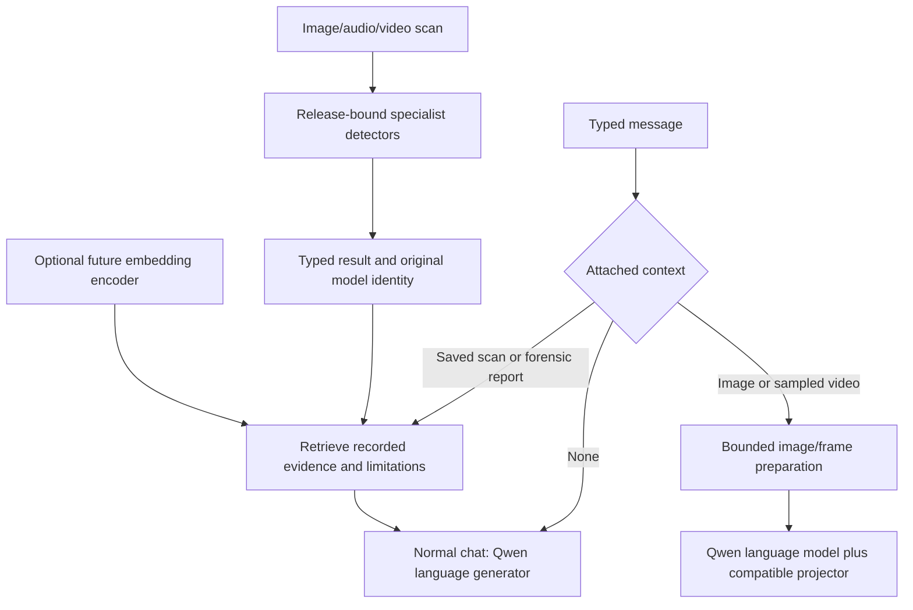

# Model selection and routing — 30 October 2026

This note verifies the supplied model screenshots and records the model/routing state inspected at the start of this revision. It separates primary-source facts, local artifact observations, and implementation recommendations. Application changes made alongside this note may supersede the starting-state routing findings below.

## Decision

Use the **existing Qwen3.5-0.8B Q4 GGUF language model plus its 1024-dimensional vision projector** as the first supported local conversational model. It is the candidate already present, supported by the native runtime, and suitable in principle for text and visual questions. This is an integration recommendation, not a claim that it has the highest answer quality on every phone. Preserve SRM/SigLIP/fusion and LCNN as task-specific detectors; a language model explains their observations and must not invent or replace their calibrated decision.

Treat **EmbeddingGemma 2 as a future retrieval encoder**, rather than a replacement chatbot. Gemma 2 2B remains a possible text-only alternative after real-device comparison, but choosing it now adds a new model/runtime configuration while not solving direct image/video understanding.

## What the screenshots establish

| Candidate | Verified function | Fit for these requirements |
|---|---|---|
| Gemma 2 2B | A text-to-text decoder, with instruction-tuned variants | Normal text chat and report explanation; no native image/video input in the core model. [Google model card](https://ai.google.dev/gemma/docs/core/model_card_2). |
| EmbeddingGemma 2 | A multimodal embedding model producing 768-dimensional vectors; 270M text parameters, optional 170M vision and 300M audio modules, 740M total | Semantic retrieval/search over files, frames and reports. It supplies vectors, not conversational answer generation. [Official model card](https://ai.google.dev/gemma/docs/embeddinggemma/model_card_2). |
| Qwen3.5-0.8B | An image-text-to-text generative model, with text-only, image and video examples in its official card | One small generator for normal chat, visual questions and evidence-grounded report answers. Native Android support still depends on the converted graph/projector and runtime. [Qwen model card](https://huggingface.co/Qwen/Qwen3.5-0.8B). |

The screenshots combine two different model families. The 270M/440M/740M modular table concerns EmbeddingGemma 2. The first screenshot's Gemma 2 2B text-generation throughput is not a benchmark of that embedding model. A vector encoder's input token rate is also not the same metric as a chatbot's generated tokens per second.

Google's launch post reports approximately **191 MB active RAM for quantized text-only weights** and **567 MB for the multimodal configuration on a Pixel 11 Pro**. These are specific published measurements, not a whole-application RAM guarantee. The supplied approximately 350 MB vision value and storage estimates were not independently established by the primary sources reviewed. [Google launch post](https://blog.google/innovation-and-ai/technology/developers-tools/embeddinggemma-2/).

The quoted **14–20 tokens/s on iPhones and 11 tokens/s on OnePlus 11** were not verified as reproducible primary-source results for this app, model file, prompt length or runtime. They must remain external anecdotes. The current JNI code explicitly sets `n_gpu_layers=0`, uses four CPU threads and a 4096-token context (`llama_forensic_jni.cpp:262–301` at inspection). A GPU/NPU result from another framework does not describe this CPU build.

Quantized file size, mapped weight pages, KV/recurrent cache, vision activations, tokenizer/runtime memory, peak RSS and free device RAM are separate measurements. Total RAM alone is insufficient for selecting a usable pack. Quantization also changes quality and latency; it needs evaluation rather than an automatic accuracy claim.

## Local artifact inventory

An immutable file inventory excluded `.git`, `.venv`, build directories, datasets, generated native dependency trees and historical agent files. It found four GGUF files, nine TFLite files, two `.task` files, two `.pth` checkpoints, one `.pt` checkpoint, one ONNX graph and eight NumPy feature-cache files. Several are duplicate or archived release copies, not different models that should be loaded together.

| Artifact | Bytes / identity | Correct role and starting-state availability |
|---|---|---|
| `android/app/src/main/assets/models/srm_forensic_cnn_int8.tflite` | 145,928 bytes | Bundled residual image model, invoked by the image and sampled-video paths. |
| `.../siglip_probe_int8.tflite` | 94,329,440 bytes | Bundled semantic image probe, optional release-checked second opinion and fusion feature. |
| `.../lcnn_audio_int8.tflite` | 520,104 bytes | Bundled speech anti-spoof detector. It is not speech transcription or speaker identity verification. |
| `.../face_landmarker.task` | 3,758,596 bytes | MediaPipe face landmarks for video diagnostic telemetry, not a chatbot or proof of deepfakes. |
| `downloaded_models/Qwen3.5-0.8B-Q4_0.gguf` | 563,036,064 bytes; GGUF architecture `qwen35`, embedding length **1024** | Actual generative language weights on the host; not automatically included in the Android APK. |
| `downloaded_models/mmproj-english-document-ocr-qwen3.5-0.8b-Q8_0.gguf` | 113,563,968 bytes; `clip` vision graph, projection dimension **1024**, metadata name `Qwen3 5 0 8b_merged_en_ocr` | Vision projector candidate. Matching dimensions are necessary but do not prove tokenizer/preprocessing/training compatibility. It needs genuine image-dependent inference checks. |
| `outputs/vlm_pack/qwen35-0.8b-v1-model.gguf` and `...-mmproj.gguf` | Hash-identical copies of those two downloaded files | Staged copies, not additional model families. |
| `gemma_cache/features.npz` | `(60,768)` feature matrix plus labels and source IDs; contract revision `self-test-fixture` | Cached test features, **not EmbeddingGemma neural weights**. They cannot encode a newly attached file. |
| `docs/test_artifacts/gemma2_eval/*.npy` and `embeddinggemma2_forensic_head.json` | Four cached feature arrays and a 768-input linear head | Research/evaluation artifacts. A tiny head without the matching backbone/runtime cannot serve new images, search documents, or generate text. Its old metrics are not new app validation. |
| `ml/checkpoints/detector.pth`, `ml/export/audioseal/audioseal_detector.onnx` | 34,667,641 / 34,801,224 bytes | AudioSeal training/export artifacts. The APK does not ship the expected AudioSeal TFLite graph; export parity, model contract and watermark-specific evaluation are required before activation. |
| `ml/checkpoints/siglip_tap_head.pt`, `release_models/srm/*.pth` | Training checkpoints | Training/export lineage inputs, not directly loadable LiteRT/GGUF deployment assets. |
| `release_models/*`, `release_v9/*`, `exported/*.npz` | Historical/candidate copies and fusion caches | Preserve for reproducibility. Do not replace current assets just because filenames match. The archived SigLIP is 94,334,896 bytes, different from the shipped 94,329,440-byte graph. |

No full Gemma 2 2B generator or complete EmbeddingGemma 2 backbone weights were found in that workspace inventory. This does not inspect arbitrary user download folders or external Hugging Face caches.

The downloaded Qwen language SHA-256 is `57d1997790d1744fba5b40a7317df71ea5e2acee28c47e78f0cce39c0703f8cf`; the projector SHA-256 is `4754476e9527e121650de789550682287611597b4c0761db97230f614a2dc320`. The corresponding `outputs/vlm_pack` copies have exactly those hashes. Together they occupy **676,600,032 bytes** (about 645 MiB) on disk, before runtime working memory.

## Why the present Qwen was not consistently used

The starting RAG route used `OnDemandForensicVlmAnalyzer.initializeActiveBackendIfAvailable`, which requires a signed forensic policy and a learned head. At inspection, `outputs/vlm_pack/forensic_vlm_policy.json` identified itself as **`fixture/untrained-parity-head` with `hidden_dim=8`**. Its staged manifest identified the backbone as **SmolVLM2-500M**, although its binary hashes point to Qwen3.5-0.8B. It was diagnostic-only and signed by a custom publisher.

Those metadata are not a valid production Qwen forensic release. The actual Qwen graph expects 1024 hidden dimensions. Refusing that head is correct; pretending it is a valid trained detector would be wrong. However, requiring that unrelated forensic head for ordinary conversation is an architectural coupling that makes otherwise usable language weights appear absent.

The starting chat generation call also passed `bitmap=null` (`ForensicRagEngine.kt:542`). Indexing an image into detector scores does not send its pixels to a VLM. The projector can be installed yet never see a visual input. The matching C++ backend already accepts optional image RGB data, so the missing work is routing, ownership and truthful capability reporting, not a claim that the pixels were already used.

A host file existing under `downloaded_models/` does not make it readable by an installed phone app. The app needs an explicit import, app-private installation or separately built bundle, a hash-bound identity, compatible model/projector metadata, and a successful native load/inference check.

## Recommended routing contract

1. Separate a **chat runtime contract** from a **forensic learned-head contract**. General chat requires a supported decoder, exact file identity and tokenizer/runtime compatibility; forensic classification additionally requires a correctly trained, calibrated, evaluated head and detector release.
2. Give model management an explicit active model/capability status: language loaded, projector available, sampled-video support, report context, retrieval encoder available/unavailable. A model name should come from the actual inspected artifact, not a filename or catalogue marketing label.
3. Add scan reports from local history directly as typed evidence. Render recorded status, score convention, coverage, model identity and limitations. Do not reclassify old scores using today's thresholds.
4. For direct image/video questions, send actual bounded visual input to the compatible projector and clearly identify sampled frames. A contact sheet or frame sample is not full-video coverage; do not infer audio transcription or voice identity without the corresponding model.
5. Keep an explicit resource lease: evict heavy specialists before VLM loading, serialize native work, enforce cancellation/deadlines, unload on release, and avoid simultaneously loading archived duplicates.
6. Use EmbeddingGemma 2 only after acquiring a real compatible encoder/export. Its useful role is query/document/media vector retrieval. Cached 60-row features and a test head are not a deployment substitute. Google's own documentation describes pairing an embedding model with a generative model for RAG. [EmbeddingGemma overview](https://ai.google.dev/gemma/docs/embeddinggemma).
7. Do not force every checkpoint into production. Every model should have a visible, accurate role: deployed, optional compatible runtime, training-only, cache, archived release, unavailable or rejected with a reason.

## Phone evaluation needed before choosing a faster backend

Measure the selected exact GGUF and projector on named physical Android phones: cold/warm time to first visible token, steady decode rate, image prefill latency, peak Java/native/RSS memory, cancellation, sustained thermal behavior, app responsiveness and answer quality. Test short normal chat, follow-ups, image/OCR questions, sampled-video questions and report-grounded questions separately. Include difficult/noisy inputs and unsupported media.

For Qwen3.5, the official card distinguishes text and visual sampling settings and warns about thinking loops in the 0.8B model. Use its actual chat template and explicit non-thinking configuration for the normal mobile experience; do not rely on `/nothink` as a supported soft switch. [Qwen guidance](https://huggingface.co/Qwen/Qwen3.5-0.8B).

The current CPU/llama.cpp path is the lowest-change baseline. A future GPU/NPU backend can be compared using a supported converted artifact and a fresh quality/memory/device test. Merely changing a dependency to LiteRT or MediaPipe does not make the existing GGUF use a phone NPU. Google's Android inference guide documents model-format and runtime-specific conversion requirements. [MediaPipe Android guide](https://developers.google.com/edge/mediapipe/solutions/genai/llm_inference/android).

The already saved emulator streaming tests demonstrate code execution and cancellation, not the screenshot's claimed iPhone/OnePlus throughput or a physical-phone latency guarantee. Neither a general generator nor an embedding encoder establishes forensic authenticity without task-specific evaluation.
