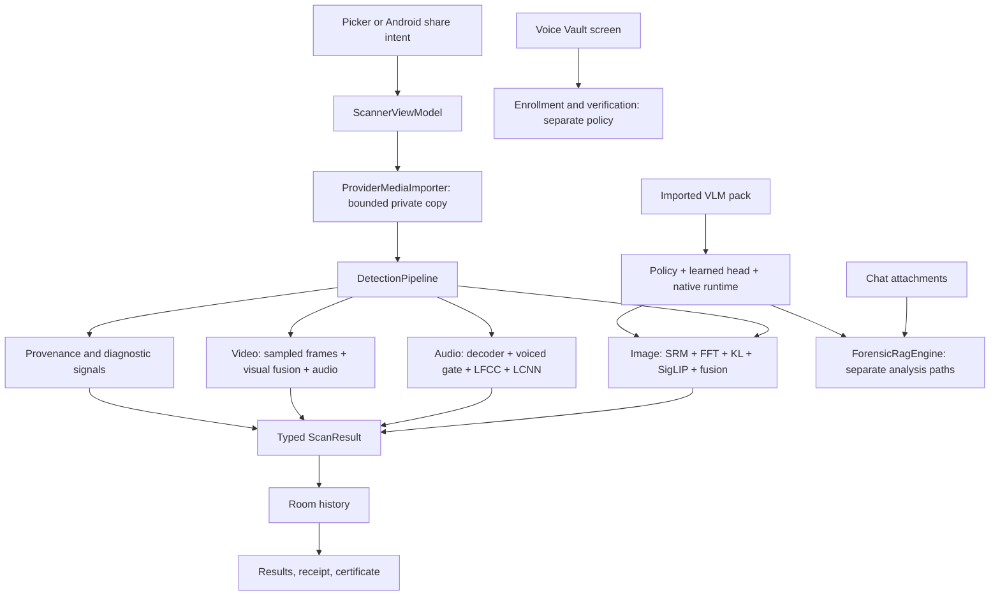

# ONN-DETECT: architecture, correctness, and completion audit

Date: 29 October 2026. Source baseline: `c1505af` on `main`; working tree was clean when the audit started.

## Assessment

ONN-DETECT has substantial working infrastructure: a native Android application, bounded media importing, local inference, grouped-data contracts, cross-language preprocessing checks, model manifests, offline provenance machinery, encrypted voice storage, and a sizeable regression suite. It is **not ready to describe as a complete, validated forensic product**. The principal blockers concern the trustworthiness of decisions and evidence, rather than missing visual polish.

The most consequential problems are inconsistent verdict enforcement across entry points, broken cryptographic binding in C2PA verification, unsupported hardware-attestation claims, uncalibrated video decisions, release pipelines that weaken their own data/evaluation safeguards, and a device benchmark that substitutes constants for measurements. Passing the present tests does not resolve these problems.

This audit preserves application code, model binaries, datasets, and existing reports. It adds analysis and audit evidence. It does not retrain models, run a physical-device accuracy benchmark, independently validate upstream dataset labels, or establish that historical performance claims are reproducible.

Detailed companion reports:

- [Detection, inference, provenance, and video](AUDIT_DETECTION_2026-10-29.md)
- [ML, data, calibration, export, and release](AUDIT_ML_2026-10-29.md)
- [Product flows, storage, chat, and model packs](AUDIT_PRODUCT_2026-10-29.md)

## 1. Scope and evidence boundaries

The tracked repository contains 597 files, including 349 source/configuration files with approximately 72,033 lines. The review inventoried the repository and traced its important execution and release paths across Android, native C++, Python ML, scripts, CI, tests, shipped JSON contracts, and current documentation. Dataset samples and model weights were inspected through their inventories, contracts, hashes, and relevant tooling; they were not manually adjudicated as a new accuracy corpus. Generated build directories, downloaded third-party sources, and historical agent working notes are not treated as authored production code.

Findings distinguish source inspection, executed checks, and missing acceptance evidence. Historical reports are context, not evidence that the current source behaves identically. A project this size needs continuing regression and device work; a repository-wide audit is not a proof that every possible defect has been found.

Severity used here: **P0** blocks security/forensic claims because evidence can be falsely promoted; **P1** blocks a reliable detector release or a major supported workflow; **P2** is important engineering/product completion work. Findings can have a high impact while their exploit or full device reproduction remains unexecuted; the companion reports identify that distinction.

## 2. Actual architecture

### Android application

The Android build defines only `:app` (`android/settings.gradle.kts`). It is an application repository with SDK-like components, not currently a separately packaged and versioned Android library SDK.

The application uses Kotlin, Compose, Navigation, Hilt, Room, LiteRT, MediaPipe, and a C++ JNI integration with llama.cpp/mtmd. Build configuration targets SDK 36, supports API 26+, and packages ARM64 and x86_64. Network permissions are explicitly removed. Backups and device transfer exclude app data.

The architectural weakness is visible in this diagram: chat and voice flows implement their own interpretation of results. They do not consistently inherit the scanner's import, validation, abstention, and evidence rules. Receipts also reconstruct some evidence after the original analysis instead of using an immutable scan snapshot.

### Image working path

`DetectionPipeline` decodes an oriented, bounded image, checks release/model contracts, obtains residual, spectral, co-occurrence, and optional semantic measurements, applies generated XGBoost fusion, and uses cascade arbitration. Provenance and document/texture diagnostics accompany the analysis. SRM uses a high-frequency PatchCraft mosaic; the semantic probe uses its own normalization and image size.

The 10 fusion features are a versioned ABI between Python and Kotlin: `srm_score`, `fft_score`, `kl_score`, `flatness_score`, `resolution_norm`, `is_compressed`, `semantic_probe_score`, `c2pa_present`, `lip_sync_corr`, `landmark_jitter`. Matching field names and vector length are necessary but insufficient: each field must retain the same measurement definition and distribution as training. Despite the `int8` filenames, the shipped manifest describes dynamic-range INT8 weights with float32 input/output, rather than a fully integer activation pipeline.

### Audio and video working paths

Audio decoding/resampling feeds a versioned LFCC frontend, speech-duration gating, LCNN scoring, and window pooling. Recording-level calibration is distinct from single-window calibration. Speaker matching is a separate biometric problem; a low spoof score cannot establish a speaker's identity.

Video samples frames and combines visual measurements with audio and diagnostic temporal/face signals. It currently changes trained feature semantics and produces a normal verdict using an explicitly provisional aggregation. An image threshold cannot automatically certify a recording-level video decision.

### Optional VLM and chat

The repository now contains a native VLM runtime and pack infrastructure. Older documentation saying no native runtime ships is stale. Runtime availability, imported weights, a compatible projector, head contracts, policy compatibility, and forensic task validation are separate requirements. A native library loading successfully is not a validated Qwen forensic detector. Optional pack identity must also be included in scan/receipt lineage when used.

### ML and release architecture

The intended flow is: acquire pinned data with authoritative labels/groups; enforce independent splits; train base models; select on validation; train fusion on independent stacking/fusion-validation pools; calibrate; evaluate sealed test slices; convert and measure the exact mobile binaries; stage a complete bundle; attach device evidence; install matching assets and generated Kotlin transactionally.

The repository contains multiple generations of this workflow. The shared training/export/release utilities implement many useful checks, but newer orchestration scripts sometimes bypass them. The default CI training flow runs `run_track4_fusion_release.py` with a v9 release identifier, while the shipped assets identify as v10. Experimental v11 and VLM tracks add further parallel paths. This fragmentation is a correctness risk because each path can redefine evidence and acceptance.

## 3. Current release status: distinguish three meanings

The shipped manifest declares `release_id=onn-prod-v10`, `validated=false`, and `desktop_validated=true`. In the manifest, `validated` means independent device validation. `ModelIntegrityChecker.Report.validated` is broader: it can permit use based on desktop validation alone (`ModelIntegrityChecker.kt:129–169`). Executing the actual checker against stock assets returned `allOk=true, validated=true, deviceValidated=false` for both required model routes. Therefore, the README statement that unvalidated assets force every statistical result to INCONCLUSIVE is not an accurate account of current runtime policy.

Three claims must be represented separately throughout the app:

1. **Artifact integrity:** bytes match declared hashes and tensor/frontend contracts.
2. **Statistical validation:** a measured detector and operating threshold satisfy declared dataset/slice acceptance criteria.
3. **Device validation:** those exact bytes and preprocessing behave as measured on the target phone/runtime.

An audit passing claim 1 does not establish claims 2 or 3. Desktop validation may be a deliberate research policy, but it must be explicit in every UI and exported certificate; it cannot silently become device or forensic assurance.

The shipped fusion report also distinguishes ranking from the operating point. `fusion/meta_results.json:37–83` records clean AUC about 0.9974 and TPR@1% FPR of 0.94, but at the **deployed threshold** 0.57819986 the recorded FPR is **5.5% clean** and **6.5% laundered**, with only 200 genuine examples in each slice. TPR@1% FPR is a different point on the ROC curve; it does not describe the false-positive rate of this deployed threshold. These are reported artifact values, not accuracy independently reproduced in this audit.

## 4. Priority findings

### F01 — P0: C2PA signature, assertion, and media binding is incomplete

`C2PAManifestChecker.kt:237–248` prefers a separate `clai` claim over the signed COSE payload. `extractDataHashes` scans the store for labels (`320–325`) and supplies those hashes independently. `C2PAVerifier.kt:91–118` checks a COSE signature, certificate chain, and media hash, but does not establish that the media hash assertion and source-type metadata are transitively authenticated by that signed claim.

Consequently, individually successful checks can be combined from different trust contexts. A signature must authenticate the exact active claim; that claim must authenticate each assertion consumed; those assertions must bind the actual asset. Fix this chain before provenance can override a statistical verdict.

An executable proof against the compiled Kotlin implementation reused identical COSE bytes while changing unsigned source metadata: the result remained `signed=true` and changed to `confirmsAI=true`. It also changed a covered media byte and recomputed the unsigned data hash while preserving the signature; the result still reported `signed=true`. The trust-store implementation additionally accepted an expired leaf certificate in a local fixture. These are synthetic ephemeral trusted-CA fixtures, not an attempted exploit against third-party signed media or a full C2PA conformance test. See [runtime proof](test_artifacts/audit_detection_2026-10-29/runtime-proof.txt).

**Acceptance:** mutate an unsigned claim, replace an assertion, transplant an unchanged valid signature onto changed media, duplicate/confuse active manifests, or alter a hashed URI target; every case must remain unverified. Positive fixtures must include genuine linked signed assertions, not merely a trusted test signature and an independently supplied media hash.

### F02 — P0: device benchmark emits fabricated measurements

`scripts/benchmark_device_arm64.py:88–129` does not execute the advertised repeated scans. It sets cold latency to 168.4 ms, generates warm latency as `142.0 + (i % 7) * 4.2`, ignores returned memory text in favor of fixed heap/PSS values, fixes thermal drift to 4.2%, and sets `all_criteria_passed=true`. `audit_zero_network_manifest` reads source rather than the APK passed to it (`55–71`); its return value is ignored by `main`. Non-ARM64 hardware only produces a warning. No-device operation exits successfully, and `--promote-release` is parsed but unused.

The script currently writes its report under `docs/test_artifacts/`; this is not evidence that the strict release validator accepts its schema or that a release was promoted. The defect is the unsupported claim that these outputs are measurements. `docs/DEPLOYMENT.md:48` also documents unsupported `--package` and `--min-runs` arguments.

**Acceptance:** instrumentation must execute real identified media, collect timings/memory/thermal observations with raw logs, fail on failed/missing scans or unsupported hardware, identify exact APK/model/frontend/fusion bytes, and emit the schema accepted by the strict release gate. Simulation must never emit production pass evidence.

### F03 — P1: chat and voice verification bypass shared verdict policy

`ForensicRagEngine` performs direct image/audio/video analysis and independently formats definitive verdicts. `VoiceEnrollmentViewModel.verifySuspiciousAudio` ignores relevant analysis status/validation and substitutes 0.2 when the audio score is absent. The resulting UI can call unavailable or unvalidated evidence authentic or verified family.

**Acceptance:** every entry point consumes one typed analysis outcome and one authoritative verdict policy. Missing/non-finite/unvalidated/failed evidence stays unavailable or inconclusive. Low spoof suspicion must never establish a positive family identity without an independently validated speaker match. Add integration tests for scanner, chat, and voice using the same failed/unvalidated fixtures.

### F04 — P1: video uses untrained feature definitions and uncalibrated aggregation

`VideoForensicAnalyzer.kt:340–375` uses `SRMForensicAnalyzer.analyze`, which returns a contrast-adjusted score rather than the rich score used by the image release. It also supplies measured landmark jitter where the training feature contract uses a fixed unsupported neutral value. It then combines frame scores using a mean/top-k heuristic and emits success despite `calibrationVersion="provisional-uncalibrated"` (`398–430`).

`VideoScorePolicy.combineMultimodalScore` also permits audio with `audioValidatedSuccess=false` to increase the decision score using a 0.35 weight. A diagnostic audio result can therefore push a recording across the synthetic threshold.

**Acceptance:** freeze identical feature semantics for a declared release; prevent unvalidated modalities from influencing decisions; calibrate the complete video sampling/aggregation route on recording-level grouped data. Until then, expose diagnostics and coverage with an inconclusive recording assessment.

### F05 — P1: training safety switches and feature-cache identity can be bypassed

`train_xgboost_meta.py:544–546` unconditionally enables overwrite, source-FPR-violation allowance, and manifest drift. The script can repurpose a validation split for stacking/fusion validation and invent group identifiers. It also overwrites loaded cache identity with current model hashes before checking reuse, allowing stale features to be attributed to different model bytes.

**Acceptance:** default fail-closed flags; independent immutable stacking/fusion-validation pools; authoritative group metadata; compare cached identity against current identity before either is mutated; reject incompatible caches without relabeling them. See the ML report for exact paths and conditions.

### F06 — P1: orchestration fabricates/relabels evidence and bypasses transactional release

`run_track4_fusion_release.py` substitutes defaults for missing measurement fields, replaces calibration split identities without rerunning calibration, and copies assets outside the transactional installer. It requires an upstream parity pass flag, but that flag does not justify filling in missing task measurements. It also copies generated Kotlin into production Android source even when installation was not requested (`298–304`). The default CI route then runs the root lineage checker against shipped Android assets rather than the staged candidate. `generate_android_constants.py` similarly substitutes an unknown probe split identity. `build_genimage_highres_dataset.py` can invent a revision on API failure, does not pin the actual dataset load to that revision, and treats byte-derived grouping as verified source ancestry.

Hashes preserve the bytes of a statement; they cannot make an unmeasured statement true.

**Acceptance:** a single release path consumes measurement outputs; it never synthesizes a pass, lineage identity, source revision, or test ancestry. Missing evidence must stop promotion. Dataset revisions must be used during acquisition, and calibration lineage must describe the data actually measured.

### F07 — P1: release validators disagree and acceptance is incomplete

The ordinary lineage/consistency/APK gates pass the current assets. The strict APK distribution gate correctly rejects missing device validation. Separately, `release_bundle.py --verify` rejects the current asset directory because the C2PA trust PEM is not in its recognized manifest asset set. Per-model acceptance in the bundle validator can be skipped when an evaluation entry lacks a nested `test` object; shipped per-model reports use flat metrics. The Kotlin desktop acceptance loop can skip malformed/missing floors and chiefly checks AUC rather than complete low-FPR criteria.

Executed temporary-fixture checks demonstrated acceptance of flat zero-TPR measurements, parity agreement zero with max error 999, and absent fusion test metrics. A separate acceptance-helper invocation accepted NaN metrics. These proofs exercise validation behavior; they do not alter shipped reports. The configured optional-probe training path also adds probe files after base export without registering their full manifest/report contracts, so that route cannot produce a strict valid bundle as wired.

**Acceptance:** use one versioned schema and fixtures shared by all validators; require evidence for every shipped decision component, trust store, and optional pack; reject incomplete acceptance records; enforce the actual deployment operating point and uncertainty. Diagnostic acceptance and distribution acceptance must have explicit, consistent names.

### F08 — P1: receipts can bind old verdicts to current model hashes

`ResultViewModel.generateReceipt` reads the current release manifest while exporting a historical Room scan. The persisted scan lacks a complete immutable model/policy digest snapshot. After an upgrade, the signed payload can combine an old verdict/version with new model hashes. Optional VLM pack identities are not fully covered. Early image outcomes can also lose the imported media hash because a nested result helper defaults its hash argument to null.

**Acceptance:** atomically persist the full evidence identity at scan completion, including media digest, model/frontend/fusion/policy/calibration hashes, optional pack identity, status, coverage, and decision rationale. Receipt export must read only that snapshot. Legacy rows must state which evidence was never recorded.

### F09 — P0: receipt verification and visual certificates overstate hardware assurance

`scripts/verify_forensic_receipt.py:129–171` checks certificate/key correspondence and adjacent issuer signatures without anchoring the chain to trusted Android attestation roots or parsing the Android attestation extension. `hardware_backed` is derived from the claimed tier string. An executed proof using the existing software EC test fixture and a self-signed certificate with no Android attestation extension returned `valid=true, hardware_backed=true` when labelled STRONGBOX. See [receipt proof](test_artifacts/audit_detection_2026-10-29/receipt-proof.txt).

`StrongBoxReceiptSigner.generateEcKey` does not request an attestation challenge; its tier detection defaults non-StrongBox and failed checks to TEE. `ForensicCertificateExporter` prints HARDWARE-ATTESTED and defaults a missing receipt to a TEE description. Local key storage, a signed payload, verified attestation, and a correct detector decision are distinct facts. A decorative certificate must not upgrade any of them.

**Acceptance:** distinguish a valid signature from trusted attestation; request and verify a challenge-bound attestation chain against the supported trust policy, check certificate validity and authenticated device/key properties, and reject self-signed software fixtures as hardware proof. Derive certificate claims from actual verified state; distinguish unsigned, software/test, TEE, StrongBox, and independently verified attestation. No default hardware claim; preserve inconclusive status and limitations.

### F10 — P1: model-pack upgrade can exhaust storage and destroy a working pack

`VlmPackManager` expands ZIP input without a total uncompressed-byte/file-count budget and removes the installed pack before replacement succeeds. A malformed/oversized pack or copy failure can fill storage or leave no usable installation.

**Acceptance:** bounded copy and extraction; canonical paths; entry count/size/ratio limits; manifest membership and exact hashes; compatible model/projector/head/policy; staged same-volume activation; retain the old pack until verification and atomic swap succeed; fault-injection tests for every interruption point.

### F11 — P1: chat import and scanner work bypass resource boundaries

RAG attachments can use full-resolution bitmap decode, unbounded PDF copying and text reads, and paths without the scanner's overall deadline. `ScannerViewModel` hashes large media on its main coroutine and performs additional voice decode/matching there. These can cause memory pressure, stalled UI, or cancellation failures on valid large inputs.

**Acceptance:** use one bounded importer/decoder for every attachment, stream with byte/page/text budgets, move hashing/DSP/file work off the UI thread, and test cancellation and low-storage/large-media behavior across every screen.

### F12 — P1: test scope is overstated

All 145 Python tests under `tests/e2e` pass. Some exercise real repository helpers and command interfaces, but many do not execute the Android feature they name. Examples in `test_tier4_scenarios.py` assign a spoof score and voice similarity, assert a literal air-gap flag, or assert a literal semantic-resilience flag. The narrowband test repeats samples rather than calling the production sinc resampler. Tier-5 tests also reproduce formulas or inspect text instead of exercising all claimed runtime paths.

These tests have value as examples/contracts where honest about scope, but cannot establish KYC compliance, bank authentication, detector resilience, Android lifecycle behavior, or end-to-end media verification. Historical fixed counts and readiness declarations further obscure the distinction.

**Acceptance:** label source checks, math fixtures, Python integration, JVM tests, Android instrumentation, device benchmarks, and accuracy evaluations separately. Replace critical scenario stand-ins with executions of production code. Build scorecards from actual runner results; never hardcode the passing count.

### F13 — P2: distribution and documentation need explicit release boundaries

Release signing silently falls back to the debug key when no production keystore exists (`android/app/build.gradle.kts:43–60`). CI verifies diagnostic APKs but does not offer a separate enforced validated-distribution job. Native CMake fetches a tag while its comment names an immutable commit. README, Android README, ROADMAP, TODO, older verification summaries, SDK claims, asset sizes/tree counts, test counts, and runtime availability disagree.

**Acceptance:** keep clearly named diagnostic builds convenient; make production signing and validated distribution fail without their prerequisites. Pin native source to an immutable revision, archive dependencies/licenses, add software/model notices and a real repository license matching the stated license, and generate a current release status page from measured artifacts. An actual SDK needs a library module, stable public API, sample integration, compatibility/versioning policy, and separate tests.

### F14 — P1: chat bypasses the model-pack trust loader

`ForensicRagEngine.kt:1127–1151` constructs the backend directly from installed pack details. `VlmPackManager.getInstalledPackDetails` parses metadata but does not perform the same full digest/trust checks as the analysis loader. Process restart can reset the in-memory custom-key state while files remain installed. This creates another parallel path around release identity enforcement.

**Acceptance:** every pack consumer obtains a verified, immutable runtime lease from the same loader; persist trusted-key policy appropriately; verify digest, signature, model/projector/head/policy compatibility after restart and before activation. A metadata getter must not confer executable trust.

### F15 — P1: native VLM close/import can race with inference

The Kotlin backend's extract/generate/close operations are not synchronized with pack replacement/uninstall. Native entrypoints access the raw context before locking, while context release deletes that pointer. This creates a use-after-free risk during concurrent operations. The risk is based on source lifecycle analysis; a device crash was not induced in this audit. Native generation also lacks a cooperative cancellation/deadline mechanism.

**Acceptance:** one owner serializes or reference-counts native runtime leases; close waits for active work; no JNI call can access a freed handle; cancellation/deadlines reach native work. Exercise repeated inference versus uninstall/replacement/close under native sanitizers or equivalent stress tooling.

### F16 — P1 for enterprise claims: KYC checks inspect the scanning phone, not the capture origin

`ScannerViewModel.kt:184–186` runs the virtual-camera detector against the phone analyzing a selected file. `VirtualCameraDetector.kt:49–95` inspects that phone's HAL/process environment. This cannot establish whether an imported video was originally injected on another device. There is also no separately consumable SDK or live-camera capture enforcement path.

The chat explanation layer is similarly limited: retrieval is lexical/tag matching over produced descriptions, and optional generation receives text with `bitmap=null`. Skin-pixel heuristics and deterministic causal tamper descriptions do not establish demographic identity or the cause of manipulation.

**Acceptance:** restrict the current claim to local environment diagnostics; implement live capture/session binding and adversarial evaluation before claiming injection prevention. Describe chat as evidence explanation and retrieval, ensure claims have measured support, and remove unsupported identity/causality assertions.

## 5. Verification performed in this audit

The following results are implementation/build observations, not new detector accuracy evidence:

The [machine-readable verification summary](test_artifacts/project_audit_2026-10-29_summary.json) records commands, suite counts, scope limits, and the rebuilt release APK digest.

| Check | Observed outcome | What it establishes |
|---|---|---|
| Tooling tests | 63 passed | Existing Python scripts/contracts regressions |
| Python scenario suite | 145 passed | Existing tests pass, with the scope limitations above |
| Tier-5 suite | 9 passed | Existing source/math/adversarial fixtures pass |
| ML pytest | 181 passed, 1 skipped, 3 subtests passed | Current ML contracts/unit behavior; 19 warnings |
| Release lineage gate | Passed | Current gate accepts declared identities/linkages |
| Android source consistency | Passed; desktop-only warning | 99 Kotlin sources, ordered 10-feature schema |
| Docs consistency | Passed | Its narrow existence/phrase/experimental-annotation checks |
| Workflow syntax/pinning checker | Passed | Structural checks on 3 workflows; not a remote CI run |
| FFT Python reference comparison | Passed | Numerical port/reference behavior on synthetic fixtures |
| Existing release APK diagnostic verifier | Passed | Packaged permissions, hashes/contracts, 64-bit 16 KiB layout |
| Same APK with `--require-validated-models` | Rejected as expected | Missing independent device validation blocks strict distribution |
| Strict bundle verification of current assets | Rejected | Unmanifested/unrecognized trust-anchor asset |
| JVM tests, lint, minified release, AndroidTest compilation | Build successful in 7m 22s; lint 0 errors, 80 warnings | Fresh build verification recorded separately from device execution |
| Python syntax | All 171 tracked Python files parsed | Source syntax only |
| Actual compiled Kotlin adversarial proofs | Reproduced C2PA trust gap, expired-leaf acceptance, unvalidated audio escalation, stock desktop-only gate behavior | Execution of current Kotlin implementation with synthetic fixtures |
| Receipt verifier adversarial proof | Software/self-signed key accepted as hardware-backed | Execution of current Python verifier with an existing synthetic fixture |

The Android unit XML produced during this audit records **405 tests across 47 suites, with zero failures/errors/skips**. Fresh `testDebugUnitTest lintDebug assembleRelease assembleDebugAndroidTest --offline --no-daemon` succeeded; compilation of Android tests is separate from executing them. Connected instrumentation and physical hardware evaluation were not executed in this review. An ADB inventory attempt could not start the local server in the restricted execution context; no claim is made that no phone exists or that connected tests passed. The device benchmark script above was inspected, not used to generate performance evidence.

## 6. Architecture changes with the highest return

1. **One analysis service and one decision policy.** Scanner, chat, voice, video, and future SDK entry points should request analysis from the same service. Presentation code may explain an outcome but must not reclassify raw scores. Distinguish detector status, evidence availability, validation level, and verdict in types.
2. **Immutable scan evidence.** Store evidence identity and decisions together at analysis time. History, chat explanation, receipts, certificates, and exports should consume that same object.
3. **One release schema and promotion path.** Training stages produce signed-off measurement artifacts; only the release tool can compose and activate a bundle. Experimental scripts should stage outputs without changing installed assets or declaring validation.
4. **Keep deterministic diagnostics outside trained features.** Texture contrast, face jitter, hotspot displays, metadata heuristics, watermark presence, and language-model narratives must not enter calibrated decisions unless specifically trained/evaluated/versioned for that role.
5. **Centralize ownership and resource limits.** One importer, decode budget, cancellation/deadline policy, inference lease, and pack activation mechanism should cover every UI path.
6. **Reduce large classes along these boundaries.** Split the 1,200-line chat/RAG engine and screen files, 1,400-line result screen, and 1,000-line fusion training script into orchestration, pure contracts, platform I/O, measurement, and presentation pieces. This is valuable after the decision/evidence contracts are fixed; cosmetic rearrangement alone will not fix duplicated policy.

## 7. Completion plan and acceptance gates

### Phase A — restore trustworthy decisions and evidence

Resolve F01–F04 and F08–F09 first. Remove fabricated device measurements from any acceptance path. Route all entry points through shared policy. Keep provisional video/recording logic diagnostic until calibrated. Bind receipts to original evidence and report hardware assurance truthfully. Restrict unsupported KYC and explanatory claims identified in F16.

**Exit gate:** adversarial provenance fixtures fail correctly; missing/failed/unvalidated evidence never produces an authentic/family confirmation in scanner, chat, voice, video, history, or certificate; historical exports retain their original identity after an upgrade.

### Phase B — make model production reproducible

Resolve F05–F07. Choose one supported baseline release and one production training workflow. Separate experiments from promotion. Audit data provenance, licenses, source/group identities, duplicates and derived variants. Freeze train/val/stacking/fusion-val/calibration/test splits with independently checked group separation. Repair cache identity and replace relabeled reports with actual measurements.

**Exit gate:** a clean environment can recreate a staged candidate from pinned sources; every reported metric maps to raw predictions, exact media identities, exact deployed binaries/frontend/fusion, and declared splits. Missing evidence stops the pipeline. All validators agree about the same bundle.

### Phase C — establish product-level statistical performance

Define supported tasks and operating points explicitly. Evaluate clean/laundered images, legitimate edits, unseen generator/source families, low-resolution content, recapture, audio languages/codecs/noise, non-speech and mixed audio, partial edits, and full recordings. Report false positives, recall, abstention/coverage, sample counts and uncertainty by source/group. Calibrate recording and video decisions separately from image/single-window thresholds.

**Exit gate:** approved error/coverage targets hold at the actual deployed thresholds on independent sealed data with enough genuine examples to support low-FPR claims. A high aggregate AUC alone does not pass.

### Phase D — finish runtime resilience and supported workflows

Resolve F10–F12 and F14–F15; add real Android integration cases for chat attachments, voice workflows, pack replacement, history upgrades/export, malformed media, background/process death, rotation, large fonts/TalkBack, low storage, cancellation, codec failures, and repeated scans. Run native VLM tests with real language/projector weights when VLM support is claimed, and report skipped real-model tests as missing coverage.

**Exit gate:** representative ARM64 phones run exact candidate bytes while disconnected; matched frontend/inference/fusion fixtures agree; latency distributions, peak memory, battery/thermal behavior, and cancellation are measured with raw evidence. No constant-filled benchmark output can satisfy this gate.

### Phase E — ship a clearly bounded release

Resolve F13. Produce a production-signed candidate, run strict APK and bundle gates, verify merged permissions/native alignment/minified runtime behavior, archive source/data/model licenses and release evidence, and publish a status page matching that candidate. Keep unavailable/experimental features visibly separate. Extract a public SDK only if it is part of the intended first release.

**Exit gate:** a fresh user can install, understand limitations, import supported media, receive a truthful assessment, inspect evidence/coverage, manage/delete data, and export a reproducible receipt. Every marketed feature has a production execution path and task-specific acceptance evidence.

## 8. Practical first work packages

| Order | Work package | Concrete deliverable |
|---|---|---|
| 1 | Provenance trust repair | Authenticated active-claim/assertion chain plus transplant/tamper regressions |
| 2 | Unified verdict enforcement | Shared analysis service used by scanner/chat/voice/video |
| 3 | Evidence persistence and certificates | Versioned immutable snapshot, history migration, truthful export |
| 4 | Release/data safeguards | Cache fix, no forced overrides, pinned acquisition, one staging/promotion tool |
| 5 | Genuine device harness | Actual instrumentation + raw measurements + strict report schema |
| 6 | Supported release evaluation | Exact-binary, grouped sealed evaluation and deployed-threshold acceptance |
| 7 | Import/pack resilience | Bounded input and atomic pack activation with failure tests |
| 8 | Distribution and documentation | Production-signing gate, validated candidate, current feature/status evidence |

Completion depends on verified data, device access, and measured outcomes. Assigning a completion percentage or guaranteed calendar estimate before those gates would conceal the main uncertainty.
